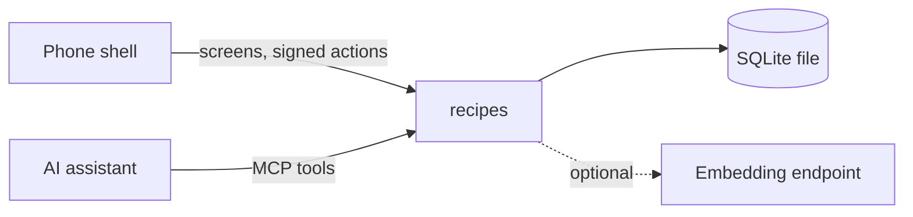

# recipes

> A small cooking journal service: save recipes, techniques, your own variations and equipment settings, find them again by words or meaning, from a phone app or an AI assistant.

## Why

I started cooking seriously and kept asking the same questions ("what is mark 5 on my oven dial, in degrees?") with nowhere to write my own variations. Recipe managers store recipes; I wanted a place for my own notes that an assistant can also read and write. This service keeps **entries** of four kinds: `recipe`, `technique`, `creation` (something I made up) and `config` (numbers for a tool, such as an oven dial). Each save adds a version; old versions stay readable.

The first entry is the oven dial: marks 1-9 mapped to degrees Celsius, seeded with the generic gas-mark scale and flagged as not measured on my oven.

## What it does

- Finds entries by plain text (SQLite full-text search) and by meaning (embeddings from any OpenAI-compatible endpoint), and combines both ranks. With no embedding service it answers with text results and says so.
- Converts degrees to a position on the oven dial by interpolating between the two nearest marks. It refuses temperatures outside the marked range instead of guessing.
- Speaks MCP (Model Context Protocol, the way assistants call tools) at `/mcp`: `entry_search`, `entry_get`, `entry_save`, `dial_convert`, `journal_stats`.
- Serves screens and actions for the [approvals](https://github.com/Egoushka/approvals) phone shell through its integration manifest at `/shell/manifest`.
- Counts its own usefulness: `GET /stats` shows entries saved and lookups of older entries against a 14-day test (at least 10 entries and 2 lookups of an entry more than a day old; both numbers are starting values to calibrate).



## Quick start

```bash
export Recipes__Token="$(openssl rand -hex 32)"   # Bearer token for /mcp, /shell and /stats
export Shell__ActionKey="$(openssl rand -hex 32)" # signs actions from the shell
export Shell__PublicUrl="https://recipes.example.org"
export Journal__Path="$PWD/recipes.db"
dotnet run --project src/Recipes
curl -fsS http://localhost:5000/healthz
```

Tests: `dotnet test recipes.slnx`. Image: `docker build -t recipes .`.

| Setting | Meaning |
|---|---|
| `Recipes__Token` | Bearer token required on `/mcp`, `/shell/*` and `/stats`. Unset closes them. |
| `Shell__ActionKey` | HMAC key shared with the shell; unset refuses every action. |
| `Shell__PublicUrl` | Public base URL; the manifest's `mcp.url` is this plus `/mcp`. |
| `Journal__Path` | SQLite file. The image uses `/data/recipes.db`. |
| `Embeddings__Url`, `Embeddings__Model`, `Embeddings__Key` | Optional. Base URL of an OpenAI-compatible `/v1/embeddings` endpoint. |

## How it works

One ASP.NET Core process, one SQLite file. Storage, validation and search live in `src/Recipes/{Storage,Domain,Search}`; the MCP tools and the shell endpoints are thin callers of the same `JournalService`, so a save from the phone and from an assistant take the same path. The design, acceptance checks and decisions are in [the v0.1 spec](docs/specs/2026-11-01-journal-v0.1.md).

Not here yet: import from a link, photos and voice, a cook log with ratings, Native AOT (see decision 3 in the spec).

## Licence

MIT. See [LICENSE](LICENSE).
